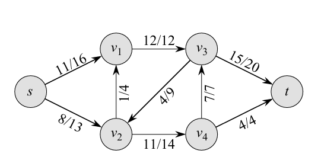
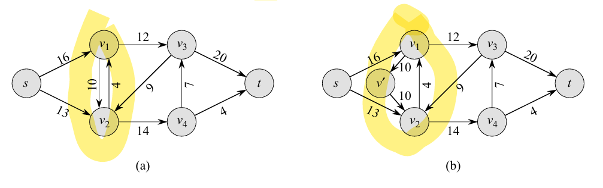
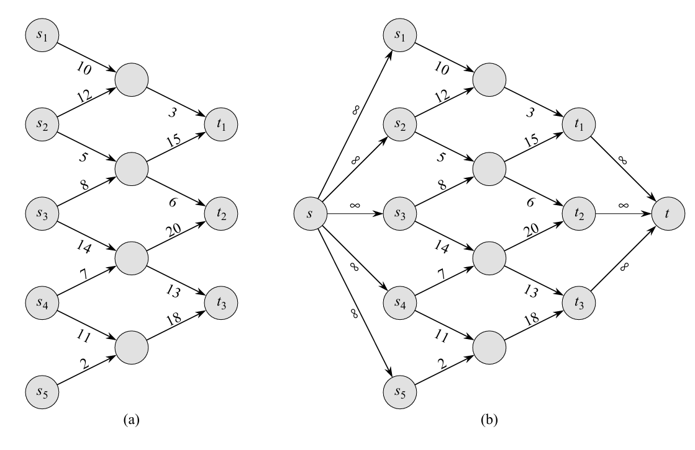
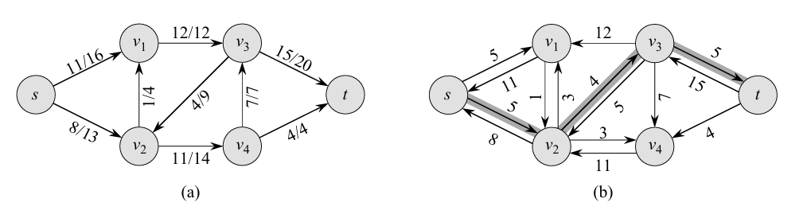
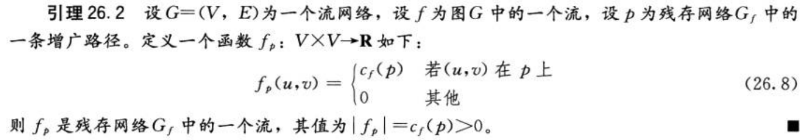
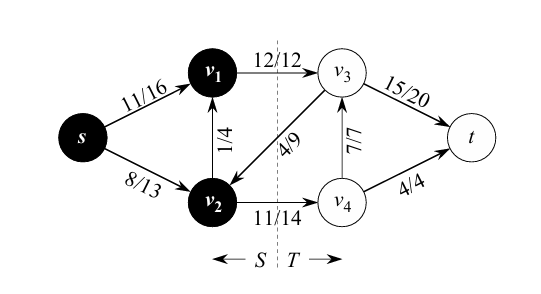
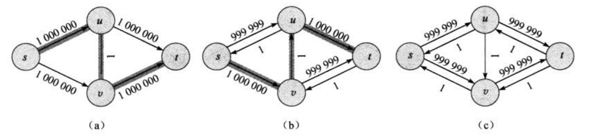
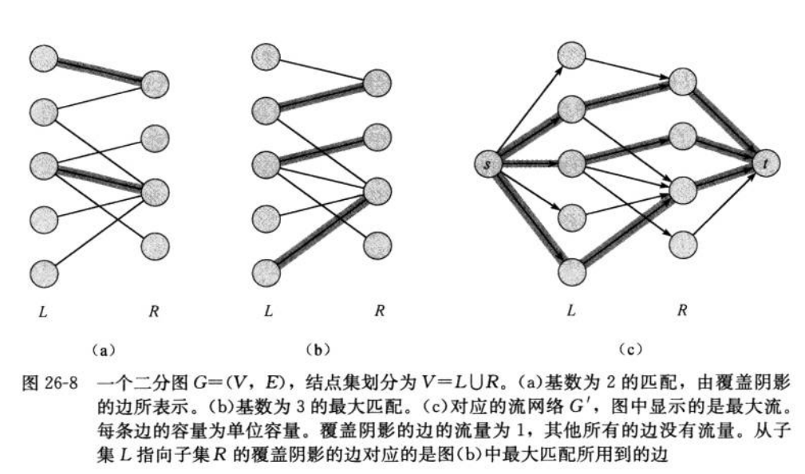

引入：想象一个城市的地下供水系统。从水厂到用户的家，中间由许多粗细不同的水管连接，每根水管都有其最大承受的**水流量**。最大流问题就是要计算出在这些水管不被撑破的条件下，单位时间内水厂最多能往用户的家输送多少


## 基本定义：

### 流网络



一个有向图 $G=(V, E)$，满足：

- 所有 $(u, v) \in E$ 有一个非负容量值 $c(u, v) \ge 0$。

- 若 $(u, v) \in E$，则图中不存在反向边 $(v, u)$。

- 不含自循环（不改变除该节点外任何其他节点的入/出流平衡，可删去）

- 两个特殊节点：**源点 $s$** 和 **汇点 $t$**


### 流 Flow

在流网络中，流定义为一个实值函数 $f: V \times V \to \mathbb{R}$

**局部变量 $f(u,v)$**：沿有向边 $u \to v$ 的实际流量

它满足2个性质：

- 容量限制：对于所有的节点 $u, v \in V$，均要求$$0 \le f(u, v) \le c(u, v)$$

- 流量守恒：任意$u \in V - \{s, t\}$，要求 $$\sum_{v \in V} f(v, u) = \sum_{v \in V} f(u, v)$$
- 任意节点 $x$ 的**净流出量**：$$net\_out(x) = \sum_{v \in V} f(x,v) - \sum_{v \in V} f(v,x)$$

（中间结点流入多少就流出多少，~~中间商不赚差价~~，这是建模假设，当成纯粹的中转站点。后续的最大流—最小割定理、残量网络构造、增广路径的正确性等都要基于此来保证推导成立。而实际上，当节点会生产、消耗或缓存时，我们可以通过引入节点的**供/需 b(v)**、连接 super-source/super-sink 或使用时间展开图等方式把问题重新建模，但那时的约束和求解方法与经典最大流有所不同，此处不做展开。）


对于一个流 $f$，其**值** $|f|$ 定义为：

$$|f| = \sum_{v \in V} f(s, v) - \sum_{v \in V} f(v, s)$$

即 s 的净产出，由于流量守恒，净出 s = 净入 t。

全局指标 $|f|$：整个网络的输出强度，由源点 $s$ 的净流出量决定


注：1.当边 $(u, v) \notin E$ 时，由于没有路径，定义 $f(u, v) = 0$。

​       2.通常流网络不会有任何流入源点的边（只是为了简化记号），因此在计算中 $\sum_{v \in V} f(v, s)$ 通常为 $0$。

### 反平行边



现实中，对于两个结点之间的“互通有无”是常见的，例如双向公路的两个车道，亦或者是把无向边建模为有向边，这是引入反平行边的起源。

但其出现会与流网络“若 $(u, v) \in E$，则图中不存在反向边 $(v, u)$”定义违背，我们采取如下办法，转化为**等价，不含反平行边的流网络**：

​      对于一对反平行边，即 $(u, v) \in E$ 且 $(v, u) \in E$，选其中一条边，如 $(u, v)$，将其从原图中删除，引入一个新中间节点 $x$，插入两条新边 $(u, x)$ 和 $(x, v)$，并将两条边的容量都设为原边 $(u, v)$ 的容量。

（$u \to x \to v$）

那么为何等价呢？给出以下论证：


**命题:** 流网络 $G$ 将边 $(u,v)$ 拆分为 $(u,x)$ 和 $(x,v)$（容量均为 $c(u,v)$）得到网络 $G'$，两者最大流相等

 我们需证明，对于 $G$ 中的任意合法流 $f$，都能在 $G'$ 中构造出一个合法流 $f'$ 使得 $|f'| = |f|$（推导 $MaxFlow(G) \le MaxFlow(G')$）；反之亦然（推导 $MaxFlow(G') \le MaxFlow(G)$）。

**1.从 $G$ 构造 $G'$：**

设已知 f 是 G 中的一个合法流，**以下是构造$G'$**的方式。

​       对于新路径：令 $f'(u,x) = f'(x,v) = f(u,v)$。

​       对于其余边：令 $f'(a,b) = f(a,b)$。

（下面我们证明构造出来的 $f'$ 确实是流）

**容量限制**：$0 \le f'(u, x) = f(u, v) \le c(u, v) = c(u, x)$，同理对于 $(x, v)$成立。

**流量守恒**：$x$仅有流入边 $(u,x)$ 和流出边 $(x,v)$，且$f'(u,x) = f'(x,v)$，严格满足流入等于流出，余节点守恒性直接由 $f$ 继承。

由于，流的值 $|f|$ 是源点 $s$ 的净流出量，$f'$ 仅在局部修改了经过 $(u,v)$ 的代数表示，无论$u$是否为源点本身，源点 s 各条发散边的流量总和$∑f(s,v)$不变，$|f'| = |f|$。

**2.从 $G'$ 构造 $G$** 

设已知 f′ 是 G′ 中的一个合法流，则必有$f'(u,x) = f'(x,v)$，设数值为$k$。

对于被复原的边：令 $f(u,v) = k$。

对于其余边：令 $f(a,b) = f'(a,b)$。

**容量限制**：由 $f'$ 的合法性可知 $k = f'(u,x) \le c(u,x)$。代入已知条件 $c(u,x) = c(u,v)$，可严格推导：

$$0 \le f(u,v) \le c(u,v)$$

**流量守恒**：原图中其余所有中间节点的流入项与流出项保持代数映射关系不变，即满足守恒。

基于源点 $s$ 的净流出量计算，合并节点 $x$不改变源点 $s$ 输出的代数和，$|f| = |f'|$。


### 最大流问题组成

图：有向图 $G=(V,E)$，可允许平行边（多条相同方向边）或两条反向的单向边，但通常不考虑自环。

容量：对每条边 $(u,v)$ 有 $c(u,v) \ge 0$ （固定）。

流的约束（对每条边定义 $f(u,v)$）：

- 容量约束：$0 \le f(u,v) \le c(u,v)$
- 流守恒：对于任意中间节点 $v \in V \setminus \{s,t\}$，$\sum_u f(u,v) = \sum_w f(v,w)$

目标：最大化流的值 $|f|$，通常定义为源的净输出：$|f| = \sum_v f(s,v) - \sum_u f(u,s)$ （若没有入 $s$ 的边，后项为 0）。

算法补充结构：残量网络 $G_f$ 用于寻找增广路径，含前向残量 $c(u,v)-f(u,v)$ 和反向残量 $f(u,v)$。


最大流问题可能存在多个源点和汇点的情况，采取添加**超级源结点**和**超级汇点**并把新增边设为“无限容量“的前提下，可使其变为只有单一源点和汇点的普通最大流问题。直观上，二者必然等价，超源可以把足够的流分配给每个原始源，超汇可以收走所有原始汇的流，故不会人为限制总流量。




## Ford-Fulkerson 方法

它提供的是一套思路，并非具体代码实现，即:  

从零流开始，不断在“残量网络”里找到一条从源 s 到汇 t 的“增广路径”，沿该路径增加尽可能多的流（瓶颈量），重复直到再也找不到增广路径。算法终止时得到的流即为最大流。


> FORD-FULKERSON-METHOD(G, s, t)
> 
> 1  initialize flow f to 0
> 
> 2  while there exists an augmenting path p in the residual network G_f
> 
> 3      augment flow f along p
> 4  return f


为便于分析理解，我们先看这几个新概念。

### 残存网络

原有的流网络中，存在有边是可以通过**正向增加**或**反向抵消**的方式来改变流量，这可以作为增加总流量的一种手段，**残存网络**就是把这两种可操作方式构成的余量空间统合在一张新图里。

也就是，残存网络中每一条有向边的值，就是残存容量，表示可以增加的额外流量。


**残存容量 $c_f(u,v)$** ：

CLRS给出的前提限定，对于任一顶点对 {u,v}，图中不会同时出现 (u,v) 和 (v,u）。在这个前提下，对每一对有序顶点 (u,v) 而言，三种情况互斥：

 

​                         $$c_f(u,v) = \begin{cases} c(u,v) - f(u,v) & \text{若 } (u,v) \in E \\ f(v,u) & \text{若 } (v,u) \in E \\ 0 & \text{其他} \end{cases}$$


那更一般性的写法(允许存在双向原始边)，对任意有序对 $(u,v)$ 都可写成：

​                           $c_f(u,v) = c(u,v) - f(u,v) + f(v,u)$

（前向残量+ 来自**对向**原始边 v→u 已发流的撤回能力，同理 c_f(v,u) = c(v,u) − f(v,u) + f(u,v)。由此可得到恒等式： **c_f(u,v) + c_f(v,u) = c(u,v) + c(v,u)**）


残量网络中，哪怕原图没有 (v,u)，残量图仍然会有一条 v→u 残量边，其容量等于 f(u,v)。




> 再总结一下：                                                                                                                                             
> 1. 原图没有反向边时，从 u 到 v 的“前向残量”就是 c(u,v) − f(u,v)；而“u->v的撤回能力”体现在残量图的**额外加的 v→u 边**上，大小是 f(u,v)，撤回能力”的主体是产生该流的原始有向边。   
> 2. 如果原图同时有 u→v 与 v→u（反平行/双向原始边），那么从 u 到 v 的总残量是**前向未用量**加上**可撤回的反向已发量**，通式为 c_f(u,v) = c(u,v) − f(u,v) + f(v,u).    故当原图不含反向原始边时，这退化为前向未用量 c(u,v)−f(u,v），也就是CLRS基于此前提而有的上述分段定义。                                                                  
> 3. 反向残量，由当前正向流 f(u,v) 产生，反向残量越大，表示越容易撤回更多的已分配流，从而给算法在后续重新分配流量时提供更大灵活性。这里尤其注意，故不能简单认为反向残量越小，递增效果越好
>

残存网络里，所谓正向即沿着原图有的边的方向。


因此，**残存网络** $G_f = (V, E_f)$ 的边集定义为：

​                         $$E_f = \{(u,v) \in V \times V : c_f(u,v) > 0\}$$

只有那些“**还有操作空间”的边**才会出现在残存网络中。


如果在残存网络 $G_f$ 中找到一条通向汇点的路，推出新流量 $f'$，更新成果无非2种方式：加与减（抵消）

这都对应着增加流的操作，称为<u>流的递增</u>。

**流的递增操作 $f \uparrow f'$ 定义：**

​                        $$(f \uparrow f')(u,v) = \begin{cases} f(u,v) + f'(u,v) - f'(v,u) & \text{若 } (u,v) \in E \\ 0 & \text{其他} \end{cases}$$

- $f(u,v)$：原图已有的流
- $+ f'(u,v)$：在残量网络中沿 u→v 顺原向推的量（前向残量 ），把这部分直接加到原来的 f(u,v)
- $- f'(v,u)$：在残量网络中沿 v→u 推的量（撤回能力），对应把原来沿 u→v 的一部分流撤回，故有减号
- 合起来，就是“把在残量网络里能做的顺/逆两类调整同时作用到原流上”的结果


那经过 $(f \uparrow f')$ 操作后，新流怎么被判断为合法呢？我们要验证其是否满足“容量限制”和“流量守恒”。


证明容量限制，即证明新的流 $0 \le (f \uparrow f')(u,v) \le c(u,v)$：

**1. 证明大于等于 0：**

$$\begin{aligned} (f \uparrow f')(u,v) &= f(u,v) + f'(u,v) - f'(v,u) \quad (\text{根据式定义})\\ &\ge f(u,v) + f'(u,v) - f(u,v) \quad (\text{因为 } f'(v,u) \le f(u,v)) \\ &= f'(u,v) \\ &\ge 0 \end{aligned}$$

$f'(v,u)$ 是残存网络里的反向流，它最多只能把原有的 $f(u,v)$ 全抵消掉，绝不会减成负数。

**2. 证明小于等于容量 $c(u,v)$：**

$$\begin{aligned} (f \uparrow f')(u,v) &= f(u,v) + f'(u,v) - f'(v,u) \quad (\text{根据定义})\\ &\le f(u,v) + f'(u,v) \quad (\text{因为流量为非负值，减去一个负数变大}) \\ &\le f(u,v) + c_f(u,v) \quad (\text{容量限制}) \\ &= f(u,v) + c(u,v) - f(u,v) \quad (\text{根据 } c_f \text{ 的定义}) \\ &= c(u,v) \end{aligned}$$

新加的流 $f'(u,v)$ 绝对不可能超过残存网络给的上限 $c_f(u,v)$，把公式代入一消，刚好等于原图的物理容量上限。


证明流量守恒 （对于残存网络中的流 $f'$，结点 $u$ 必须满足流量守恒）

​     因为 $f$ 和 $f'$ 均遵守流量守恒性质，对于所有的结点 $u \in V - \{s, t\}$ 都有：

​           $$\sum_{v \in V} (f \uparrow f')(u, v) = \sum_{v \in V} (f(u, v) + f'(u, v) - f'(v, u))$$（流出节点u)

​      $$= \sum_{v \in V} f(u, v) + \sum_{v \in V} f'(u, v) - \sum_{v \in V} f'(v, u)$$ （替换为流入量）

​     $$= \sum_{v \in V} f(v, u) + \sum_{v \in V} f'(v, u) - \sum_{v \in V} f'(u, v)$$

​      $$= \sum_{v \in V} (f(v, u) + f'(v, u) - f'(u, v))$$

​      $$= \sum_{v \in V} (f \uparrow f')(v, u)$$

为凑代数格式而替换，得到新流的流入结点 $u$ （即从 $v$ 到 $u$）的定义公式，所以增广后的新流 $(f \uparrow f')$ 合法。

**证明新流的值 $|f \uparrow f'| = |f| + |f'|$：**

​         回归定义：$$|f| = \sum_{v \in V} f(s, v) - \sum_{v \in V} f(v, s)$$

​         这里处理个边界问题：**增广操作 $(f \uparrow f')(u, v)$ 的定义，是基于原图 $G$ 中存在的边 $(u, v) \in E$**，如果两点没边，无法套用上述定义式。我们给出两个集合：

​         **$V_1$ **：所有**源点 $s$ 能直接通向**的节点（即存在出边 $(s, v) \in E$）。

​         **$V_2$ **：所有**能直接通向源点 $s$** 的节点（即存在入边 $(v, s) \in E$）。

**无反平行边前提**：因为流网络不允许双向边同时存在，所以一个节点不可能既在 $V_1$ 又在 $V_2$，即 $V_1 \cap V_2 = \emptyset$。

没有交集的话，所以有  $\sum_{v \in V_1} f'(s, v) + \sum_{v \in V_2} f'(s, v)$  （==这里v是不同的点！==）可以直接合并为 $\sum_{v \in V_1 \cup V_2} f'(s, v)$ （流出源点 $s$ 的“新水流”总和），$\sum_{v \in V_1} f'(v, s) + \sum_{v \in V_2} f'(v, s)$ 可以合并为（流入源点 $s$ 的“新水流”总和） $\sum_{v \in V_1 \cup V_2} f'(v, s)$，故：

​        $|f \uparrow f'|=$ $$ \sum_{v \in V_1} f(s, v) - \sum_{v \in V_2} f(v, s) + \sum_{v \in V_1 \cup V_2} f'(s, v) - \sum_{v \in V_1 \cup V_2} f'(v, s)$$

（所以，这两处合并可以理解成---$V_1$ 和 $V_2$分别提供的**推进能力和撤回能力**构筑的）


书上说，可以将4个求和项的范围都扩展到整个结点集合 $V$ 上，因为每个额外的项的值都为0，为什么？

对于 $\sum f(s, v)$：如果 $v$ 不在 $V_1$ 里，说明 $s$ 到 $v$ 根本没边。没边的地方，水流 $f(s, v)$ 显然是 0。

对于 $\sum f(v, s)$：如果 $v$ 不在 $V_2$ 里，说明 $v$ 到 $s$ 没边，水流 $f(v, s)$ 也是 0。

对于 $f'$ 也是同理，如果在原图里的点和 $s$ 不挨着，那在残存网络里该点与 $s$ 的流量互动由守恒看也必然是 0，我们实质关注的是与s直连的边去计算$s$ 的**净流出量**。


改变底标：$$|f \uparrow f'| = \left( \sum_{v \in V} f(s, v) - \sum_{v \in V} f(v, s) \right) + \left( \sum_{v \in V} f'(s, v) - \sum_{v \in V} f'(v, s) \right)$$


### 增广路径

**增广路径 $p$**：在残存网络里，找到了一条从源点 $s$ 到汇点 $t$ 的**简单路径**，即表示可以继续增加其额外流。

**增广操作 $(f \uparrow f')$**：原来的叠加新流 $f'$，使总流量变大，就是增广的过程。

如何增广呢？假设找到一条增广路径 $p$，能加的水量取决于这条路上**最窄的管子**，即瓶颈容量$c_f(p)$。



此处指明新加的水流 $f_p$，**就是残存网络 $G_f$ 中的一个合法流**。

（前面$f'$ 是泛指任何一种合法的增量。$f_p$ 是特指，是算法执行过程中找出来的**某一条**具体的增广路径 $p$ 上携带的水流，此时其余的边被无视，暂定其增加的流量为0，等加上这股新增的水流后，重新更新残存网络里的各边残存容量，重复上述过程，这也是Ford-Fulkerson算法的核心思路。故作为局部增量$f_p$帮助我们找到最大流：<u>当我们无法继续找到一条完整的通路 $p$时，被叠加无数次的$f$，才是真正的**最大流**</u>）


那么，由于我们知道对于**任何**残存网络里的合法流 $f'$，都有 $(f \uparrow f')$ 是合法流，且 $|f \uparrow f'| = |f| + |f'|$ 成立（26.1），而构造的函数 $f_p$ 也是**一个合法流**，并且它的值 $|f_p| > 0$，则可以把引理 26.1 中的 $f'$ 全局替换成 $f_p$，便有：

​        1.$(f \uparrow f_p)$ 是原图 $G$ 中的一个合法流。

​        2.新流的值 $|f \uparrow f_p| = |f| + |f_p|$。

​        3.因为已知 $|f_p| > 0$，所以 $|f| + |f_p| > |f|$。

因此，对 $f$ 增加流量 $f_p$所形成的流是 $G$ 中一个值严格大于 $|f|$ 的流。（26.3）

### 流网络的切割

刚才提到的找到最大流的终止条件，本质上是**最大流最小切割定理**给出的：一个流是最大流当且仅当残存网络不包含任何增广路径。为了后续证明，我们将引入如下概念：

**切割：**在流网络中，把结点集合一分为二，即$S$ 和 $T=V-S$ 两个集合，保证 $s \in S, t \in T$都是合法切割。（类似于划分水厂和用户）



若 $f$ 是一个流，则定义横跨切割 $(S, T)$ 的**净流量** $f(S, T)$ 如下：

​              $$f(S, T) = \sum_{u \in S} \sum_{v \in T} f(u, v) - \sum_{u \in S} \sum_{v \in T} f(v, u) \quad $$

切割 $(S, T)$ 的**容量**是：

​               $$c(S, T) = \sum_{u \in S} \sum_{v \in T} c(u, v) \quad $$

这两个求和符号就是专门找**跨越边界**节点对（对应算法的双重循环），去求正流量和负流量的总和之差。

这里，书上提到流的定义和切割容量的定义之间存在着不对称性，指的是我们算实际净流量时要减去反向流的，但算容量c（最多能送过去多少），我们只看源点到汇点的最大通行力度，这与反向流容量无关。


一个网络的**最小切割**是整个网络中容量最小的切割。

（~~最小肯定最小啊~~，其实就是寻求绝对瓶颈，因为合法的切割方式很多，会得到不同的容量数值，而容量数值min的那种切法，就叫“最小切割（Minimum Cut），它意味着所以能从S跨域T的正向跨越通道容量在此处达到最小，而这是整个网络能够传输的最大真实流量---最大流）

所以，每一次在残存网络里找增广路径，其实就是在不断地“试探”这道最窄门槛，无路可走即这条边界上已经满载了。（后面会证明这一点）

先介绍两个引理，用于推导后面的最大流最小割定理：

> 设 $f$ 为流网络 $G$ 的一个流，该流网络的源结点为 $s$，汇点为 $t$，设 $(S, T)$ 为流网络 $G$ 的任意切割，则横跨切割 $(S, T)$ 的净流量为 $f(S, T) = |f|$。 (26.4)

人话：在源点和汇点之间随意划一条线，横跨这条线的“净流水量”，永远等于源点发出的总流水量 $|f|$

**数学推导：**

1. 宏观总流量 $|f|$ 定义为：源点 $s$ 流出去的水 - 流回源点 $s$ 的水

2. 由守恒知道集合 $S$ 里除源点 $s$ 外的其他所有中间节点净流出量为0

3. 把源点 $s$ 的净流出量，加上集合 $S$ 里所有其他普通节点的净流出量总和依然等于 

   $$|f|= \sum_{v \in V} \sum_{u \in S} f(u, v) - \sum_{v \in V} \sum_{u \in S} f(v, u)$$

   $|f| = (\text{集合 } S \text{ 向全图所有节点 } V \text{ 流出的总和}) - (\text{全图 } V \text{ 向集合 } S \text{ 流入的总和})$

4. 集合 $S$ 向外流出，可分成2个部分：一部分流给了 $S$ 内部的节点，一部分流给了对面的集合 $T$。

​                  $S$ 内部的流动，是可以抵消的，故全部处理后，只剩下 $S$ 流向 $T$ 的部分，这正是“切割 $(S,T)$ 的净流量 $f(S,T)$”，得证 $|f| = f(S,T)$。


> 流网络 $G$ 中任意流 $f$ 的值不能超过 $G$ 的任意切割的容量。（26.5）
>
> 

**证明** ：

​       设 $(S, T)$ 为流网络 $G$ 的任意切割，设 $f$ 为 $G$ 中的任意流。根据引理 26.4 和容量限制性质，我们有： 

​                  $$|f| = f(S, T) = \sum_{u \in S} \sum_{v \in T} f(u, v) - \sum_{u \in S} \sum_{v \in T} f(v, u)$$                                                                                                                                                                  

​                 $$\le \sum_{u \in S} \sum_{v \in T} f(u, v) \le \sum_{u \in S} \sum_{v \in T} c(u, v) = c(S, T) \quad $$

​                  $(\text{从 } S \text{ 到 } T \text{ 的实际流水量}) \le (\text{从 } S \text{ 到 } T \text{ 的管道总容量 } c(S, T)$


**最大流最小割定理**：

​         设 $f$ 为流网络 $G=(V, E)$ 中的一个流，该流网络的源结点为 $s$，汇点为 $t$，则下面的条件是等价的：

1. $f$ 是 $G$ 的一个最大流。
2. 残存网络 $G_f$ 不包括任何增广路径。
3. $|f| = c(S, T)$，其中 $(S, T)$ 是流网络 $G$ 的某个切割。

证明：（循环论证法：$(1) \Rightarrow (2) \Rightarrow (3) \Rightarrow (1)$）

   1.  (1) $\Rightarrow$ (2)：反证，若残存网络 $G_f$ 同时包含一条增广路径 $p$，根据26.3，对其增加流量 $f_p$所形成的流是 $G$ 中一个值严格大于 $|f|$ 的流，与假设矛盾。

   2.  (2) $\Rightarrow$ (3)：既然残存网络 $G_f$ 中不存在任何从源结点 $s$ 到汇点 $t$ 的路径，则流的蔓延必然停留在某个边界上。那按照这个边界切，有：

  集合 $S$： 在残存网络中，水滴从 $s$ 出发**能**流到的所有节点（包括 $s$ ）

     集合 $T$： 在残存网络中，水滴**到不了**的所有节点（因为不存在到 $t$ 的路，所以 $t$ 必然在集合里）

      此时，形成了**一个切割 $(S, T)$！**

      现在看跨越这条边界线上的原图水管（从 $u \in S$ 指向 $v \in T$）的状态：

      $u \to v$：如果$f(u,v) < c(u,v)$，则会有剩余容量，此时能从 $u$ 流到 $v$，和假设矛盾，故已达上限

      $v \to u$：如果先前在这条路回退过（$f(v,u) > 0$），则残存网络就会建立一条“退流”的反向边 $u \to v$，这又和假设矛盾，故该边$f(v, u) = 0$。

      因此，根据穿过任意切割的净流量都等于总流量 $|f|$，现在这条边界净流量为：

      $|f| = (\text{从 } S \text{ 流向 } T \text{ 的实际水量}) - (\text{从 } T \text{ 流回 } S \text{ 的实际水量})$ 

      因为正向满载，反向全无：

      $|f| = (\text{所有正向管子的容量上限之和}) - (0) = c(S, T)$

      故找不到路时，总流量刚好等于这个边界的容量。

   3. (3) $\Rightarrow$ (1)：根据26.5，对于所有切割 $(S, T)$，$|f| \le c(S, T)$，条件 $|f| = c(S, T)$ 隐含着 $f$ 就是一个最大流。（木桶效应，关注最短板）


### 基本的Ford-Fulkerson算法实现：


```c
FORD-FULKERSON(G, s, t)
1  for each edge (u, v) ∈ G.E
2      (u, v).f = 0//原图所有有向边的真实流量 f都设置为 0
3  while there exists a path p from s to t in the residual network G_f//运行时间
4      c_f(p) = min{c_f(u,v) : (u,v) is in p}
5      for each edge (u, v) in p
6          if (u, v) ∈ E   //残存边为原图的边
7              (u, v).f = (u, v).f + c_f(p)
8          else //反向边
               (v, u).f = (v, u).f - c_f(p)
               
```


分析：原先的基础FF算法，没有规定应该选择哪一条增广路径，如果每次找到的增广路径只能让总流量增加 1 个单位，那么算法最多需要执行 $|f^*|$ 次循环，用 DFS 或 BFS 找路径需要 $O(E)$ 的时间，因此总时间复杂度是 $O(E|f^*|)$。 显然，$|f^*|$ 若很大，时间无限延长，这被认为是**伪多项式时间**复杂度，因为它依赖于输入数值的大小，而不是仅仅依赖于图的顶点数 $V$ 和边数 $E$。




## Edmonds-Karp 算法


使用BFS去搜索增广路径，在数学上被证明，每次都选最短增广路径，总的**增广次数最多只有 $O(VE)$ 次**。由于每次 BFS 需要 $O(E)$ 的时间，所以总的时间复杂度稳定在 **$O(VE^2)$**


1. 如果 Edmonds-Karp 算法运行在流网络 $G=(V, E)$ 上，该网络的源结点为 $s$ 汇点为 $t$，则对于所有的结点 $v \in V - \{s, t\}$，残存网络 $G_f$ 中的最短路径距离 $\delta_f(s, v)$ 随着每次流量的递增而单调递增。

（我们每次都挑**最短的路线**，当他被占满，以后我们想重新经过这片区域，只能被迫去绕远路，或者走那个反向管道，需要的步数（距离）都必然比原来长）


2.  如果 Edmonds-Karp 算法运行在源结点为 $s$ 汇点为 $t$ 的流网络 $G=(V, E)$ 上，则该算法所执行的流量递增操作的总次数为 $O(VE)$。（Edmonds-Karp 算法的迭代次数的上界）

   

1.每次找到一条增广路径，路径上至少有一条边流量达到上限，关键边（Critical Edge）

2.这条关键边 $(u, v)$ 一旦达到上限，它就从残存网络中**消失**

它什么时候再次出现**？只有当后续的某次增广，水**反向流过 $(v, u)$ 时，这条边 $(u, v)$ 才会被释放出来。

3.但根据前面的引理，距离是不断增加的。水从正向流过时，源点到 $u$ 的距离是 $d$；等水反向流过时，距离至少变成了 $d + 2$

4.一个网络最长有多长？最多只有 $|V|$ 个节点（距离最多是 $|V|$-1）。每次消失到再出现距离加 2，所以一条边最多成为“关键边” $|V|/2$ 次

5.网络里一共只有 $E$ 条边，每条边最多当 $|V|/2$ 次关键边。所以，总共找增广路的次数绝不会超过 $E \times (|V|/2) = O(VE)$ 次


代码实现如下：

```cpp
#include <iostream>
#include <vector>
#include <queue>
#include <algorithm>

using namespace std;

const int INF = 1e9;

// 寻找增广路径，并记录路径上的前驱节点
bool bfs(int s, int t, int n, vector<vector<int>>& residualGraph, vector<int>& parent) {
    fill(parent.begin(), parent.end(), -1);
    queue<int> q;
    q.push(s);
    parent[s] = s; // 标记源点已访问

    while (!q.empty()) {
        int u = q.front();
        q.pop();

        for (int v = 0; v < n; v++) {
            // 如果节点未访问，且残存容量大于 0
            if (parent[v] == -1 && residualGraph[u][v] > 0) {
                parent[v] = u;
                if (v == t) return true; // 找到汇点即可返回
                q.push(v);
            }
        }
    }
    return false; // 找不到增广路径
}

int fordFulkerson(int s, int t, int n, vector<vector<int>>& graph) {
    // 建立残存网络，初始状态等同于原图的容量
    vector<vector<int>> residualGraph = graph;
    vector<int> parent(n);
    int maxFlow = 0;

    // 伪代码第 3 行：只要残存网络中还存在增广路径
    while (bfs(s, t, n, residualGraph, parent)) {
        int pathFlow = INF;

        // 伪代码第 4 行：找出路径上的瓶颈容量 c_f(p)
        for (int v = t; v != s; v = parent[v]) {
            int u = parent[v];
            pathFlow = min(pathFlow, residualGraph[u][v]);
        }

        // 伪代码第 5-8 行：更新残存网络中的正向边和反向边
        for (int v = t; v != s; v = parent[v]) {
            int u = parent[v];
            
            residualGraph[u][v] -= pathFlow;
            // 建立/增加反向边容量
            residualGraph[v][u] += pathFlow;
        }

        maxFlow += pathFlow;
    }

    return maxFlow;
}

int main() {
    int n = 6; //  s=0, v1=1, v2=2, v3=3, v4=4, t=5
    vector<vector<int>> graph(n, vector<int>(n, 0));

    
    graph[0][1] = 16; graph[0][2] = 13; // s -> v1, s -> v2
    graph[1][2] = 10; graph[2][1] = 4;  // v1 <-> v2
    graph[1][3] = 12;                   // v1 -> v3
    graph[2][4] = 14;                   // v2 -> v4
    graph[3][2] = 9;                    // v3 -> v2
    graph[3][5] = 20;                   // v3 -> t
    graph[4][3] = 7;  graph[4][5] = 4;  // v4 -> v3, v4 -> t

    int max_flow = fordFulkerson(0, 5, n, graph);
    cout << "计算得到的最大流为: " << max_flow << endl; 

    return 0;
}
```


## 最大二分匹配




将一个**组合优化问题**（二分匹配），装成一个**网络流问题**，用现成的 Ford-Fulkerson (FF) 算法解决。

在二分图 $G=(V, E)$ 中，顶点被严格划分为两个不相交的集合 $L$（左）和 $R$（右），所有的边一定是一端在 $L$，另一端在 $R$。

- **匹配的定义**：选出一些边，使得图中**没有任何一个顶点被两条或以上的边共享**，就是选出的边集 $M$ 中，每个顶点的度数最大为 1。
- **最大匹配**：在所有合法的匹配方案中，包含边数最多的那个方案。


（把一个机器集合 $L$ 和要同时执行的任务集合 $R$ 相匹配。$E$ 中有边 $(u, v)$ 就说明一台特定的机器 $u \in L$ 能够完成一项特定的任务 $v \in R$。最大匹配能够让尽可能多的机器运行起来）

**定理 26.10 (完整性定理)** 如果容量函数 $c$ 只能取整数值，则 Ford-Fulkerson 方法所生成的最大流 $f$ 满足 $|f|$ 是整数值的性质。而且，对于所有的结点 $u$ 和 $v$，$f(u, v)$ 的值都是整数。


如何建图？

**设立超级节点**：在图外凭空创造两个节点，源点 $s$（Source）和汇点 $t$（Sink）

**重定向所有的边**：将原本 $L$ 和 $R$ 之间的无向边，变成从 $L$ 指向 $R$ 的有向边

**连接超级节点**：从 $s$ 向 $L$ 中的每一个节点连一条有向边；从 $R$ 中的每一个节点向 $t$ 连一条有向边

**容量限制（最关键）**：将新图 $G'$ 中**所有的边**的容量都设定为 **1**  （使得匹配1对1


##  推送-重贴标签算法

1.预流与超额流：

推送-重贴标签算法并不在整个执行过程中保持流量守恒性质。不过，在执行过程中，它维持一个**预流 (preflow)**，该预流是一个 $V \times V \to R$ 的函数 $f$，满足容量限制性质和下面弱化了的流量守恒性质：对于所有的结点 $u \in V - \{s\}$，进入一个结点的流可以超过流出该结点的流。 结点 $u$ 的**超额流 (excess flow)** $e(u)$ 是进入该结点的流超过流出该结点的流的部分。如果 $e(u) > 0$，则称结点 $u$ **溢出**

2.高度函数：

设 $f$ 为 $G$ 的一个预流。如果函数 $h: V \to N$ 满足 $h(s) = |V|$， $h(t) = 0$，并且对于所有的边 $(u, v) \in E_f$，有 $h(u) \le h(v) + 1$，则 $h$ 是一个**高度函数**

3.PUSH (推送)

```c++
PUSH(u, v)
1  // Applies when: u is overflowing, c_f(u, v) > 0, and u.h = v.h + 1.
2  // Action: Push Δ_f(u, v) = min(u.e, c_f(u, v)) units of flow from u to v.
3  Δ_f(u, v) = min(u.e, c_f(u, v))
4  if (u, v) ∈ E
5      (u, v).f = (u, v).f + Δ_f(u, v)
6  else (v, u).f = (v, u).f - Δ_f(u, v)
7  u.e = u.e - Δ_f(u, v)
8  v.e = v.e + Δ_f(u, v)
```


4.基本操作：RELABEL (重贴标签)

```c++
RELABEL(u)
1  // Applies when: u is overflowing and for all v ∈ V such that (u, v) ∈ E_f, we have u.h <= v.h.
2  // Action: Increase the height of u.
3  u.h = 1 + min{v.h : (u, v) ∈ E_f}
```


5.初始化与主循环

```c++
INITIALIZE-PREFLOW(G, s)
1  for each vertex v ∈ G.V
2      v.h = 0
3      v.e = 0
4  for each edge (u, v) ∈ G.E
5      (u, v).f = 0
6  s.h = |G.V|
7  for each vertex v ∈ s.Adj
8      (s, v).f = c(s, v)
9      v.e = c(s, v)
10     s.e = s.e - c(s, v)

GENERIC-PUSH-RELABEL(G)
1  INITIALIZE-PREFLOW(G, s)
2  while there exists an applicable push or relabel operation
3      select an applicable push or relabel operation and perform it
```

