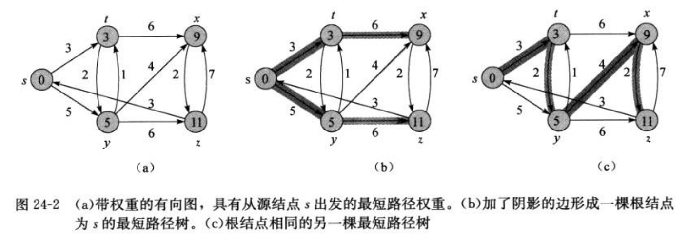
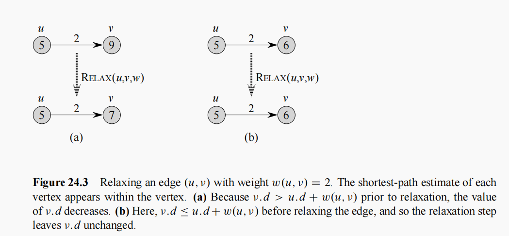
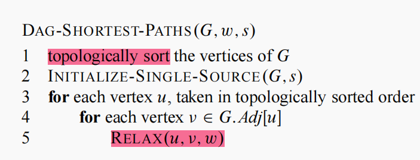
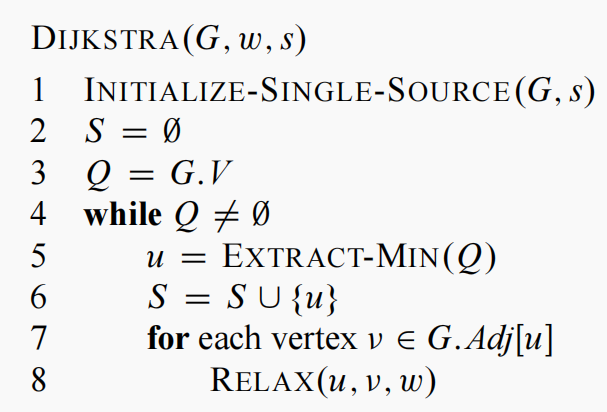
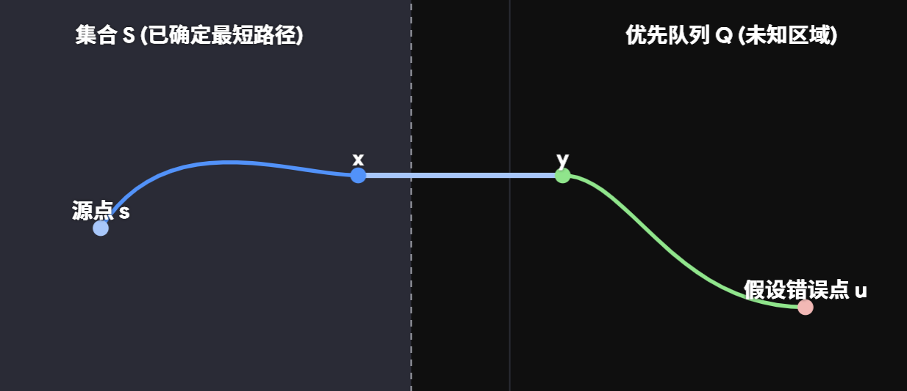
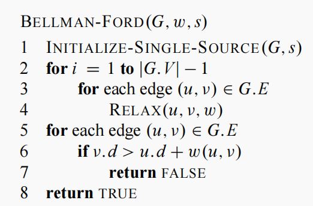
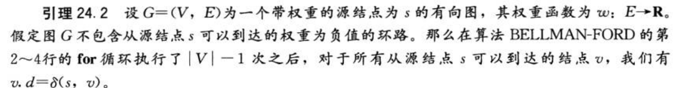
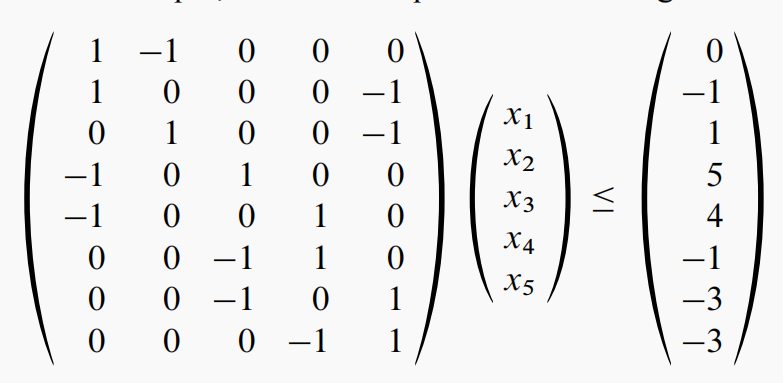

**引入：**

单源，本质是一个“一对多”的关系，给定图中的一个唯一的起始点，计算出从这个点出发，到达图中**所有其他可达顶点**的最短距离，也是后续探寻单节点对的最短路径的基础。

### 前置定义：

**图与权重**

在最短路径问题中，给定一个带权重的有向图 $G=(V, E)$ 和权重函数 $w: E \to \mathbf{R}$，该权重函数将每条边映射到实数值的权重上。图中一条路径 $p = \langle v_0, v_1, \dots, v_k \rangle$ 的权重 $w(p)$ 是构成该路径的所有边的权重之和，数学表达为：

$$
w(p) = \sum_{i=1}^k w(v_{i-1}, v_i)
$$

**最短路径权重 $\delta(u, v)$**

定义从结点 $u$ 到结点 $v$ 的最短路径权重 $\delta(u, v)$ 如下：

$$
\delta(u, v) = \begin{cases} \min \{w(p): u \stackrel{p}{\leadsto} v\} & \text{如果存在一条从结点 } u \text{ 到结点 } v \text{ 的路径} \\ \infty & \text{其他（即不可达）} \end{cases}
$$

故结点 $u$ 到结点 $v$ 的最短路径，则为任何一条权重恰好等于最短路径权重（即 $w(p) = \delta(u, v)$）的从 $u$ 到 $v$ 的路径 $p$。

==不可达的情况：==

什么时候会不存在呢？我们得考虑一个结构：环路。

- **环路总权值为负**：显然，你可以随心所欲在上面绕圈，中间不管选哪条路径，都可以达成 $-\infty$ 的成就，但我们需要一个有限的下界。
- **环路总权值为正**：假设存在一条从 $v_0$ 到 $v_k$ 的**最短**路径 $p$ 包含了这个正权重的环路 $c$。当我们用剪贴法把正环剔除掉，我们会得到一条相较于之前总权重更小的路径，假设失效。

剩下权重为 $0$ 的环路，通过把它重复删去，我们一样可以得到权重相同、更为简化的路径（简单路径）。

因此，我们可以假定在找到的最短路径中没有环路，也不会丢失一般性。

`毕竟算法关注的也是权值本身，而不是路径形状`

除去环路，路径的权值可以为负。在接下来的算法当中，**Bellman-Ford 算法**允许输入包含负权重的边，并且可以报告路径中是否含有权重为负的环路。而**Dijkstra 算法**的前提则为输入的边权重为非负值。

（权重的本质是一种广义的“代价”，并非物理距离，故与之相应的“收益”若大于代价时，净权重就可以被定义为负数）

### 前置提要：

- **最优子结构**：最短路径的核心规律是“最短路径的子路径依然是最短路径”。
- **最短路径的表示**：除了计算出最短路径权重，我们还需要知道这个路径是怎么走，因此需要一种数据结构来记录路径。

给定图 $G=(V, E)$，对于每个结点 $v$，我们维持一个前驱结点 $v.\pi$。该前驱结点可能是另一个结点或者 $\text{NIL}$。

- **$v.\pi$**：用来记录在最短路径上 $v$ 的“前驱结点”是谁。如果还没找到路，它就是 `NIL`。
- **$v.d$**：$s$ 到 $v$ 的最短路径估计，即 $s$ 到 $v$ 最短路径权重的上界。

由 $\pi$ 值所衍生的**前驱子图 $G_{\pi} = (V_{\pi}, E_{\pi})$**，我们定义结点集 $V_{\pi}$ 为**图 $G$ 中的前驱结点不为 $\text{NIL}$ 的结点**的集合，再加上源结点 $s$，即：

$$
V_{\pi} = \{v \in V : v.\pi \neq \text{NIL}\} \cup \{s\}
$$

有向边集合 $E_{\pi}$ 是由 $V_{\pi}$ 中的结点的 $\pi$ 值所衍生的边的集合，即：

$$
E_{\pi} = \{(v.\pi, v) \in E : v \in V_{\pi} - \{s\}\}
$$

（对于上面找出的每一个结点 $v$（除了源点 $s$ 本身），把它和它的前驱结点连起来，形成一条从“前驱”指向“当前结点”的边，即 $(v.\pi, v)$）——路径还原。

当最短路径算法跑完后，$G_{\pi}$ 是一棵树，即**最短路径树 (Shortest Path Tree)**。此处我们可以先直观理解一下原因：
1. 每个结点最多只有一个前驱（只有一个父节点）。
2. 这些被选中的边不会形成环路（因为环路会导致无限绕圈，违背最短路径的贪心原则）。

**最短路径树的定义：**

设 $G=(V, E)$ 是一条带权重的有向图，其权重函数为 $w: E \rightarrow \mathbf{R}$。假定 $G$ 不包含从 $s$ 可以到达的权重为负值的环路，因此，所有的最短路径都有定义。一棵根结点为 $s$ 的最短路径树是一个有向子图 $G'=(V', E')$，这里 $V' \subseteq V$，$E' \subseteq E$：
1. 包含只要是源点能到达的所有结点。
2. 每个结点只有一个父节点。
3. 对于页面的结点 $v \in V'$，图 $G'$ 中从结点 $s$ 到结点 $v$ 的唯一简单路径是图 $G$ 中从结点 $s$ 到结点 $v$ 的一条最短路径。

CLRS 也提到，这和 BFS 的广度优先树本质一致，只不过我们可以把它看作是在解决**无权图**的最短路径问题，所有边的权重都是 $1$，边数总和最少就是最短路径。

当然，最短路径不一定是唯一的，最短路径树也不一定是唯一的。



注意评判标准：是保证从源点 $s$ 出发，顺着树枝走到任何一个单独结点的距离，都是全图理论上的最小值。

- **松弛（Relaxation）**：
  - **三角不等式性质**：对于任何边 $(u, v) \in E$，我们有 $\delta(s, v) \le \delta(s, u) + w(u, v)$。
  - **上界性质**：对于所有的结点 $v \in V$，我们总是有 $v.d \ge \delta(s, v)$。一旦 $v.d$ 的取值达到 $\delta(s, v)$，其值将不再发生变化。
  - **路径松弛性质**：如果 $p = \langle v_0, v_1, \dots, v_k \rangle$ 是从源结点 $s = v_0$ 到结点 $v_k$ 的一条最短路径，并且我们对 $p$ 中的边所进行松弛的次序为 $(v_0, v_1), (v_1, v_2), \dots, (v_{k-1}, v_k)$，则 $v_k.d = \delta(s, v_k)$。该性质的成立与任何其他的松弛操作无关，即使这些松弛操作是与对 $p$ 上的边所进行的松弛操作穿插进行的。
  - **前驱子图性质**：对于任何带权有向图，如果经过一系列的松弛操作后，使得对于所有能从源点 $s$ 到达的结点 $v$，都有 $v.d = \delta(s, v)$，那么此时的前驱子图 $G_\pi$ 必定是一棵根节点为 $s$ 的最短路径树。

INITIALIZE-SINGLE-SOURCE($G, s$)
1  for each vertex $v \in G.V$
2      $v.d = \infty$
3      $v.\pi = \text{NIL}$
4  $s.d = 0$

对一条边的 $(u, v)$ 的松弛过程为，将从 $s$ 到 $u$ 之间的最短路径距离加上结点 $u$ 与 $v$ 之间的边权重，并与当前的 $s$ 到 $v$ 的最短路径估计进行比较。

RELAX($u, v, w$)
1  if $v.d > u.d + w(u, v)$
2      $v.d = u.d + w(u, v)$
3      $v.\pi = u$



为什么不能把等号加给 `>`（即写成 `>=` 并且执行更新）呢？
为了防范零权环。若写成 `>=` 并且执行更新，图中存在两个**互相连接且边权为 0** 的结点 $A$ 和 $B$，那它们算出来的距离永远相等，就会陷入“A 认为 B 是前驱，B 又认为 A 是前驱”的无限套娃，导致死循环。

### 有向无环图的单源最短路径问题（Directed Acyclic Graph）

无环，意味着图中各个结点的先后顺序是清晰的，故我们可以先用**拓扑排序**将其线性排序，以此作为处理各节点的**处理顺序**，然后分别去找相应的邻接链表进行松弛操作。

**那多种拓扑排序会有影响吗？**（因为处于同一层级的节点会衍生多种情况）

不妨假设图中存在边 $(A, C)$ 和 $(B, C)$，拓扑排序保证 $A$ 和 $B$ 都必定在 $C$ 之前被处理。此时，$A.d$ 和 $B.d$ 已经计算完毕，且是最优解。

假设：
$Path_A = A.d + w(A, C)$
$Path_B = B.d + w(B, C)$

**情况一：拓扑排序是 $\dots A \dots B \dots C \dots$**
1. **处理 $A$ 时**：内存执行 `C.d = min(C.d, Path_A)`。因为此时 $C.d$ 是 $\infty$，所以 $C.d$ 被覆写为 $Path_A$。
2. **处理 $B$ 时**：内存执行 `C.d = min(C.d, Path_B)`。此时 $C.d$ 里面存的是 $Path_A$，所以实际执行的是 `C.d = min(Path_A, Path_B)`。

**情况二：拓扑排序是 $\dots B \dots A \dots C \dots$**
1. **处理 $B$ 时**：内存执行 `C.d = min(C.d, Path_B)`。因为此时 $C.d$ 是 $\infty$，所以 $C.d$ 被覆写为 $Path_B$。
2. **处理 $A$ 时**：内存执行 `C.d = min(C.d, Path_A)`。此时 $C.d$ 里面存的是 $Path_B$，所以实际执行的是 `C.d = min(Path_B, Path_A)`。

因此，拓扑排序只是保证在处理当前结点时，它的所有前置的松弛操作全部处理完毕，前面的松弛顺序对最终结果无影响。

**DAG 最短路径算法的定理陈述：**

如果带权有向图 $G$ 没有环（DAG），且有源点 $s$。那么在 DAG-SHORTEST-PATHS 算法终止时：
1. 对于所有结点 $v$，其最短路径估计值必定等于真实最短距离：$v.d = \delta(s, v)$。
2. 前驱子图 $G_\pi$ 必定是一棵最短路径树。



分析：
拓扑排序：$\Theta(V+E)$  
初始化：$\Theta(V)$  
双层循环：$\Theta(V+E)$  

> **聚合分析**：对于一个数据结构执行一个由 $n$ 个操作组成的序列，如果无论如何最坏情况下，这 $n$ 个操作的**总运行时间上限**是 $T(n)$。那么在聚合分析中，我们认为每个操作的平均（摊还）代价就是 $T(n)/n$。  
> 触发条件 1：内层操作的次数，受到全局物理资源的严格限制  
> 触发条件 2：状态的改变是“单向”且“不可逆”的  
> 也就是找到全局总限制，比如指针总共只能走 $N$ 步，或者栈里的元素最多只能被 `pop` 出去 $N$ 次

**给出该算法的正确性证明：**

**情况 1**：如果结点 $v$ 根本无法从源点 $s$ 到达  
真实最短距离 $\delta(s, v) = \infty$。根据算法初始化（设为 $\infty$）且没有边能更新它（无路径性质），最终 $v.d = \infty$。

**情况 2**：如果结点 $v$ 可以从源点 $s$ 到达  
则必然存在一条真实的最短路径 $p = \langle v_0, v_1, \dots, v_k \rangle$（其中 $v_0 = s$, $v_k = v$）。

根据**路径松弛性质**，只要我们**按照最短路径上边的顺序**，依次松弛 $(v_0, v_1)$，然后 $(v_1, v_2)$，一直到 $(v_{k-1}, v_k)$，那么最终 $v_k.d$ 绝对等于真实的最短距离 $\delta(s, v_k)$。至于在这些关键松弛操作**之间**穿插了多少其他乱七八糟的边松弛，都**完全不影响**最终结果。

在 DAG 中，由于路径 $p$ 是一条有向路径，所以 $v_0$ 指向 $v_1$，$v_1$ 指向 $v_2\dots$，那根据**拓扑排序的定义**：如果存在边 $(u, v)$，那么 $u$ 必定排在 $v$ 前面，则这条最短路径上，结点在拓扑排序中的出场顺序**一定是** $v_0, v_1, v_2, \dots, v_k$。

既然算法是按照拓扑排序的顺序来取出结点并松弛它的出边，所以，边 $(v_0, v_1)$ **绝对**比边 $(v_1, v_2)$ 先被松弛。

结论：当算法终止时，$v_i.d = \delta(s, v_i)$ 必然成立。由于所有距离都正确，根据**前驱子图性质**，$G_\pi$ 自然就是一棵最短路径树。

当然，DAG 解决的是无环的情况，那对于有环而言，我们无法得到一个线性序，就需要采取动态决策（贪心）的思路。

那么从特殊的情况，可以有环但不能有负权值的边开始，我们引入 Dijkstra 算法。

### Dijkstra 算法

**核心**：全局状况未知，根据**“贪心思想”**，那就在目前所有还没处理完的节点中，每次只挑那个**当前离正在处理的点最近（$v.d$ 最小）**的结点，放入集合 $S$（已确定最短路径的结点），然后更新优先队列 $Q$ 里的每点距离，取其最小，移入 $S$，如此循环。



Dijkstra 算法正确性证明：

- **非路径性质**：如果从结点 $s$ 到结点 $v$ 之间不存在路径，则总是有 $v.d = \delta(s, v) = \infty$。
- **收敛性质**：对象某些结点 $u, v \in V$，如果 $s \leadsto u \to v$ 是图 $G$ 中的一条最短路径，并且在对边 $(u, v)$ 进行松弛前的任意时间有 $u.d = \delta(s, u)$，则在之后的所有时间有 $v.d = \delta(s, v)$。

我们使用反证法：设结点 $u$ 是**第一个**被算法错误地放入 $S$ 的，即 $u.d > \delta(s, u)$。那么在原图中，**必定存在一条真正的最短路径 $p$** 从源点 $s$ 连到 $u$。因为源点 $s$ 早就在集合 $S$ 里了，目标点 $u$ 正准备被拉入 $S$，所以 $p$ **必然有一脚跨出了集合 $S$ 的边界**。设这条路径上，最后一个在 $S$ 内部的节点是 $x$，它跨出边界后的第一个在 $S$ 外部的节点是 $y$，即 $s \leadsto x \to y \leadsto u$。



因为 $x$ 在 $S$ 里面，$x.d = \delta(s, x)$。$x$ 当初被加入 $S$ 时，它一定对边 $(x, y)$ 进行了松弛，$y$ 的距离也被完美算对了，即 $y.d = \delta(s, y)$。在真正的最短路径 $p$ 上，$y$ 是 $u$ 的前置路段。因为**图里没有负权边**，从 $y$ 走到 $u$ 的这段路 $y \leadsto u$ 的权重 $\ge 0$，则：

$$
\delta(s, y) \le \delta(s, u)
$$

从而有：

$$
y.d = \delta(s, y) \le \delta(s, u)
$$

而我们假设算法算错了 $u$，即 $\delta(s, u) < u.d$，连带推出 $y.d < u.d$。那因为优先队列 $Q$ 里 $y$ 和 $u$ 都在，贪心策略却没有选择估计值更小的 $y$ 而是选择了 $u$，这就和贪心思想的选择产生矛盾。

结论：Dijkstra 算法贪心拉入集合 $S$ 的每一个节点，其距离都是绝对的最短距离。

```cpp
#include <iostream>
#include <vector>
#include <queue>
#include <climits> 

const int INF = INT_MAX;
struct Edge {
    int to;
    int weight;
};
struct State {
    int id;         
    int distFromS;  

    // 重载大于号，让 priority_queue 变成最小堆 (默认是最大堆)
    bool operator>(const State& other) const {
        return distFromS > other.distFromS;
    }
};

class Graph {
private:
    int V; 
  
    std::vector<std::vector<Edge>> adj; 

public:
    Graph(int v) : V(v), adj(v) {}

  
    void addEdge(int u, int v, int weight) {
        adj[u].push_back({v, weight});
    }

  
    void dijkstra(int source) {
        // 记录到各个节点的最短距离，初始化为无穷大
        std::vector<int> dist(V, INF);
        // 记录前驱节点，用于最后还原路径 (对应书中的 \pi)
        std::vector<int> prev(V, -1); 
        
        // 最小优先队列
        std::priority_queue<State, std::vector<State>, std::greater<State>> pq;


        dist[source] = 0;
        pq.push({source, 0}); // 对应书中的 INSERT 操作

        // 主循环
        while (!pq.empty()) {
            // 【步骤 2: 提取当前距离最小的节点】对应 EXTRACT-MIN
            State current = pq.top();
            pq.pop();

            int u = current.id;
            int d = current.distFromS;

            // 【核心防御：懒惰删除机制】
            // 如果弹出的这个状态，它的距离比我目前已知的最短距离还要大，
            // 说明这是一个历史遗留的“废弃”状态，直接忽略。
            if (d > dist[u]) {
                continue; 
            }
            // 【步骤 3: 遍历并松弛所有出边】
            for (const auto& edge : adj[u]) {
                int v = edge.to;
                int weight = edge.weight;

                // RELAX (松弛操作)
                if (dist[u] + weight < dist[v]) {
                    dist[v] = dist[u] + weight;
                    prev[v] = u; // 记录前驱，维持最短路径树
                    
                    // 【对应书中的 DECREASE-KEY】
                    // 我们不修改队列中已有的 v，而是直接推入一个新的更优状态
                    pq.push({v, dist[v]}); 
                }
            }
        }
        printResult(source, dist, prev);
    }

private:
    void printResult(int source, const std::vector<int>& dist, const std::vector<int>& prev) {
        std::cout << "源点 " << source << " 到各节点的最短距离：\n";
        for (int i = 0; i < V; ++i) {
            if (dist[i] == INF) {
                std::cout << "节点 " << i << ": 无法到达\n";
            } else {
                std::cout << "节点 " << i << ": 距离 = " << dist[i];
                // 还原并打印路径
                std::cout << "  (路径: ";
                std::vector<int> path;
                for (int curr = i; curr != -1; curr = prev[curr]) {
                    path.push_back(curr);
                }
                for (int j = path.size() - 1; j >= 0; --j) {
                    std::cout << path[j] << (j == 0 ? "" : " -> ");
                }
                std::cout << ")\n";
            }
        }
    }
};

int main() {
    // 构造一个 5 个节点的图 (编号 0 到 4)
    int V = 5;
    Graph g(V);

    // 添加边 (u, v, weight)
    g.addEdge(0, 1, 10);
    g.addEdge(0, 2, 3);
    g.addEdge(1, 3, 2);
    g.addEdge(2, 1, 4);
    g.addEdge(2, 3, 8);
    g.addEdge(2, 4, 2);
    g.addEdge(4, 3, 9);

    g.dijkstra(0);

    return 0;
}
```
分析：

大头取决于最小优先队列实现。

1.Array $O(V^2) + O(E)$  =$O(V^2) $  

2.Binary Min-Heap  $O(V \log V) + O(E \log V)$ = **$O((V + E) \log V)$**  = 稀疏图

3.Fibonacci Heap    （ $O(V \log V + E)$，EXTRACT-MIN 的摊还代价地证明为 **$O(\log V)$**


考虑到有的图存在负权值的边，于是引入Bellman-Ford 算法。

### Bellman-Ford 算法

**核心：**无法预知节点顺序，贪心因负权边失效，那就暴力地在每一轮迭代中对图里所有的有向边进行**无差别松弛**，更新邻居的最短距离。通过**连续进行 $V-1$ 轮**的全局遍历（相当于求出最多经过 $V-1$ 条边的最优解），让所有结点的距离达到理想的最短路径；若第 $V$ 轮仍能成功松弛，则可判定存在负权环。




**路径松弛性质** 如果 $p = \langle v_0, v_1, \dots, v_k \rangle$ 是从源结点 $s = v_0$ 到结点 $v_k$ 的一条最短路径，并且我们对 $p$ 中的边所进行松弛的次序为 $(v_0, v_1), (v_1, v_2), \dots, (v_{k-1}, v_k)$，则 $v_k.d = \delta(s, v_k)$。该性质的成立与任何其他的松弛操作无关，即使这些松弛操作是与对 $p$ 上的边所进行的松弛操作穿插进行的。

以下给出证明：

1.假设图中**没有**负权环




（归纳证明：$v_{i-1}.d = \delta(s, v_{i-1})$，当算法松弛边 $(v_{i-1}, v_i)$ 时，根据**松弛操作的定义**，它会把 $v_i$ 的距离更新为 $v_{i-1}.d + w(v_{i-1}, v_i)$，得到$\delta(s, v_i)$，由于归纳过程是按顺序的，$v_k.d = \delta(s, v_k)$成立）

$v.d = \delta(s, v)$得证，不可到达点初始化的 $\infty$ 值就是正解，故所有$v.d$ 均达到了最优值

松弛结束后，会检查$v.d > u.d + w(u, v)$，根据三角不等式（对于任意边 $(u, v)$，必有 $\delta(s, v) \leq \delta(s, u) + w(u, v)$），则有$v.d \leq u.d + w(u, v)$，故只返回TRUE。


2.假设图中**存在**负权环（反证）

**假设**：假设图中存在可从 $s$ 到达的负权环 $c = \langle v_0, v_1, \dots, v_k \rangle$（其中 $v_0 = v_k$），且算法返回了 TRUE

**条件约束**：如果算法返回 TRUE，说明对于环上的每一条边 $(v_{i-1}, v_i)$，在最后一次迭代后，均满足：

$$v_i.d \leq v_{i-1}.d + w(v_{i-1}, v_i)$$


对环上的 $k$ 条边，将这些不等式相加：

$$\sum_{i=1}^{k} v_i.d \leq \sum_{i=1}^{k} v_{i-1}.d + \sum_{i=1}^{k} w(v_{i-1}, v_i)$$

环是封闭的，$v_0 = v_k$，所以项 $\sum_{i=1}^{k} v_i.d$ 和 $\sum_{i=1}^{k} v_{i-1}.d$ 包含了完全相同的顶点集合 $\{v_1, \dots, v_k\}$

抵消后，$$0 \leq \sum_{i=1}^{k} w(v_{i-1}, v_i)$$

因为最初定义 $c$ 为负权环，即 $\sum_{i=1}^{k} w(v_{i-1}, v_i) < 0$，经推导得出，$0$<=负数，故假设不成立。


```cpp
#include <iostream>
#include <vector>
#include <climits>

const int INF = INT_MAX;

struct Edge {
    int u;      // 起点
    int v;      // 终点
    int weight; 
};

class Graph {
private:
    int V; 
    int E;
    std::vector<Edge> edges; 

public:
    Graph(int v, int e) : V(v), E(e) {}
    void addEdge(int u, int v, int weight) {
        edges.push_back({u, v, weight});
    }
    bool bellmanFord(int source, std::vector<int>& dist) {
        
        dist.assign(V, INF);
        dist[source] = 0;

       
        for (int i = 1; i <= V - 1; ++i) {
            bool relaxed = false; // 某一轮没有任何更新，说明已经收敛，提前退出
            for (const auto& edge : edges) {
                int u = edge.u;
                int v = edge.v;
                int weight = edge.weight;

                // 防止 INF + weight 导致整数溢出
                if (dist[u] != INF && dist[u] + weight < dist[v]) {
                    dist[v] = dist[u] + weight;
                    relaxed = true;
                }
            }
            if (!relaxed) {
                break; 
            }
        }

        // 第 V 轮负责检测负权环
        for (const auto& edge : edges) {
            int u = edge.u;
            int v = edge.v;
            int weight = edge.weight;

            if (dist[u] != INF && dist[u] + weight < dist[v]) {
                // 还能松弛则一定存在负权环
                return false; 
            }
        }
        return true;
    }
};
```

​            $$dp[k][v] = \min \left( dp[k-1][v], \min_{\text{所有指向 } v \text{ 的边 } (u,v)} \left( dp[k-1][u] + weight(u, v) \right) \right)$$

分析：

​     $O(V \cdot E)$


**差分约束与最短路径**

**差分约束系统**：一个线性规划矩阵A的每一行里，只有一个 $1$ 和一个 $-1$，其他全是 $0$



​                     $$x_j - x_i \le b_k$$       我们要求出一组满足所有这些限制的 $x$ 的值

**平移不变性：**如果 $x = (x_1, x_2, ..., x_n)$ 是一组解，那么对于任何常数 $d$，给每个未知数都加上 $d$，即 $(x_1+d, x_2+d, ..., x_n+d)$，依然是正确的解

(当然，y=x+b，该直线上的点都满足)

​                   $$x_j \le x_i + b_k$$    <->    $\delta(s, j) \le \delta(s, i) + w(i, j)$ (最短路的性质)

即：从起点走到顶点 $j$ 的距离，不能超过从起点先走到顶点 $i$，再通过一条权重为 $b_k$ 的边走到 $j$ 的距离

因而得到**约束图Constraint Graph**：

**顶点：**  $x_i$ 对应 $v_i$     **有向边：**  $x_j - x_i \le b_k$，从顶点 $v_i$ 指向顶点 $v_j$ 的边，边的权重是 $b_k$ 。 

==还要加上源点$v_0$==：图不一定全连通，故引入该点， $v_0$ 向图中其他顶点 $v_i$ ，都连一条权重为 $0$ 的边。

通过**bellman-ford算法**，有两种情况。

1.无负权环，算出了从 $v_0$ 到每个点 $v_i$ 的最短距离 $\delta(v_0, v_i)$，则$x_i = \delta(v_0, v_i)$。

2.有负权环，无解。


因为有 $n+1$ 个顶点和 $n+m$ 条边，所以时间复杂度为 $O((n+1)(n+m)) = O(n^2 + nm)$。


**最短路径性质证明**

现在，我们回顾一下前面提到的各种性质，给出证明：

> ##### **三角不等式性质(引理 24.10)** 
> 对于任何边 $(u, v) \in E$，我们有 $\delta(s, v) \le \delta(s, u) + w(u, v)$。

> ##### **上界性质(引理 24.11)** 
> 设 $G=(V, E)$ 是一个带权有向图，权值函数 $w : E \to \mathbb{R}$。设 $s \in V$ 为源点，且图已经被初始化。对于所有的结点 $v \in V$，我们总是有 $v.d \ge \delta(s, v)$。一旦 $v.d$ 的取值达到 $\delta(s, v)$，其值将不再发生变化。

**数学归纳法：**

我们先证明所有的 $v \in V$，始终有 $v.d \ge \delta(s, v)$，归纳主体为松弛步骤的数量。


**basis:**  刚初始化完 (n=0)，$v.d \ge \delta(s, v)$ 显然成立。因为对于所有的 $v \in V - \{s\}$，都有 $v.d = \infty$。对于源点，有 $s.d = 0 \ge \delta(s, s)$（注：如果 $s$ 在负权环上，$\delta(s, s) = -\infty$，否则为 0）

我们假设：整个图经历了 $n$ 次松弛操作之后，对于图中的所有顶点 $x$，它的距离估计值 $x.d$ 都必定>=真正的最短路径 $\delta(s, x)$

**inductive step:**   (n+1) 考虑对某条边 $(u, v)$ 执行松弛操作。由归纳假设，在松弛之前对于所有的 $x \in V$ 都有 $x.d \ge \delta(s, x)$。本次操作中唯一可能改变的估计值是 $v.d$。如果它真的发生了改变，则有：

​                                               $$v.d = u.d + w(u, v)$$

​                                            $$\ge \delta(s, u) + w(u, v) \quad \text{(由归纳假设)}$$

​                                            $$\ge \delta(s, v) \quad \text{(由三角不等式)}$$

因为我们已经证明了 $v.d \ge \delta(s, v)$，所以它已经达到下界，不可能再减小；同时，松弛操作的设计决定了它永远不会去增加 $d$ 的值，所以它也无法变大，故一旦 $v.d = \delta(s, v)$ 就不会再改变。

> ##### **非路径性质(推论 24.12)** 
> 如果从结点 $s$ 到结点 $v$ 之间不存在路径，则总是有 $v.d = \delta(s, v) = \infty$                                                     

**证明：** 由刚才证得的上界性质可知，始终有 $\infty = \delta(s, v) \le v.d$。因此必然得出 $v.d = \infty = \delta(s, v)$


> ##### **收敛性质(引理 24.14)** 
> 对于某些结点 $u, v \in V$，如果 $s \leadsto u \to v$ 是图 $G$ 中的一条最短路径，并且在对边 $(u, v)$ 进行松弛前的任意时间有 $u.d = \delta(s, u)$，则在之后的所有时间有 $v.d = \delta(s, v)$                              **引理24.13：**对于边 $(u, v) \in E$，在执行了 `RELAX(u, v, w)` 之后，立刻会满足 $v.d \le u.d + w(u, v)$

**证明：**

根据上界性质，如果 $u.d$ 在松弛 $(u, v)$ 前的某一点达到了 $\delta(s, u)$，那么这个等式此后将一直成立。特别地，在松弛边 $(u, v)$ 之后，我们有：

$$v.d \le u.d + w(u, v) \quad \text{(由引理 24.13)}$$    $$= \delta(s, u) + w(u, v)$$

$$= \delta(s, v) \quad \text{(最短路径的子路径也是最短路径)}$$

再结合上界性质 $v.d \ge \delta(s, v)$，夹逼得出 $v.d = \delta(s, v)$。


> ##### **路径松弛性质(引理 24.15)** 
> 如果 $p = \langle v_0, v_1, \dots, v_k \rangle$ 是从源结点 $s = v_0$ 到结点 $v_k$ 的一条最短路径，并且我们对 $p$ 中的边所进行松弛的次序为 $(v_0, v_1), (v_1, v_2), \dots, (v_{k-1}, v_k)$，则 $v_k.d = \delta(s, v_k)$该性质的成立与任何其他的松弛操作无关，即使这些松弛操作是与对 $p$ 上的边所进行的松弛操作穿插进行的。                                                                                                                                       

**证明：**

使用归纳法证明：在路径 $p$ 的第 $i$ 条边被松弛后，有 $v_i.d = \delta(s, v_i)$。

- **基础情况 ($i=0$)：** 在任何边被松弛前，初始化使得 $v_0.d = s.d = 0 = \delta(s, s)$。由上界性质，$s.d$ 永远不会改变。

- **归纳步骤：** 假设在松弛 $(v_{i-1}, v_i)$ 之前已有 $v_{i-1}.d = \delta(s, v_{i-1})$。根据刚才证明的**收敛性质**，只要松弛了边 $(v_{i-1}, v_i)$，立刻会有 $v_i.d = \delta(s, v_i)$，并且一直保持。

  

最后，需要证明，当估计值全部收敛后，我们记录的前驱指针（$\pi$ 属性）所衍生出的子图 $G_\pi$，就是一棵最短路径树。

> **引理 24.16**：假设图中**不包含**从源点 $s$ 可达的负权环。那么在初始化之后，前驱子图 $G_\pi$ 会形成一棵以 $s$ 为根的有根树，并且此后的任何松弛序列都不会破坏这一不变量

证明：初始时 $G_\pi$ 只有源点 $s$，显然成立。

经历一系列松弛后，我们先用反证法证明 $G_\pi$ 是**无环的**：

假设某次松弛在 $G_\pi$ 中意外产生一个环 $c = \langle v_0, v_1, \dots, v_k \rangle$（其中 $v_k = v_0$）。那么对于环上的每一个点，必定有 $v_i.\pi = v_{i-1}$。不失一般性，假设是最后松弛边 $(v_{k-1}, v_k)$ 时把环给封闭了。

环 $c$ 上的所有点必定都是从 $s$ 可达的（因为它们拥有前驱，意味着被赋予了有限的估计值，由上界性质可知一定可达）。

在调用导致成环的 `RELAX` 之前，对于前面所有的点 $i = 1, \dots, k-1$，都有 $v_i.\pi = v_{i-1}$。这说明 $v_i.d$ 之前是因为执行了 $v_i.d = v_{i-1}.d + w(v_{i-1}, v_i)$ 而更新的。由于距离值只会变小，所以在这个决定性的 `RELAX` 瞬间，我们有：

$$v_i.d \ge v_{i-1}.d + w(v_{i-1}, v_i) \quad \text{对所有 } i = 1, 2, \dots, k-1 \text{ 成立}$$

而因为最后一次调用改变了 $v_k.\pi$，说明当时满足了严格不等式条件：

$$v_k.d > v_{k-1}.d + w(v_{k-1}, v_k)$$

$$\sum_{i=1}^k v_i.d > \sum_{i=1}^k (v_{i-1}.d + w(v_{i-1}, v_i)) = \sum_{i=1}^k v_{i-1}.d + \sum_{i=1}^k w(v_{i-1}, v_i)$$

∴  $$0 > \sum_{i=1}^k w(v_{i-1}, v_i)$$

因此，$G_\pi$ 绝对是无环的。

最后再证明每个节点在 $G_\pi$ 中只有唯一一条路径通向 $s$（图中每个节点只有一个父节点，不可能分叉）。假设有两条路径，必然会在某一点 $z$ 汇合，这意味着 $z$ 同时拥有两个**不同的前驱 $x$ 和 $y$**，这与数据结构中一个节点只能存一个 $\pi$ 值矛盾 。


> 
>
> 
>
> ##### **前驱子图性质(引理 24.17)**
>  假设图不包含负权环。执行完能让所有点收敛（即 $v.d = \delta(s, v)$）的松弛操作后，前驱子图 $G_\pi$ 就是一棵以 $s$ 为根的最短路径树。

**证明：**

只需验证它满足最短路径树的三大要素：

1. **节点全包含**：最短路径存在当且仅当节点可达，而可达当且仅当 $v.\pi \neq \text{NIL}$，所以 $V_\pi$ 包含了所有可达点。

2. **树结构**：引理 24.16 证明了它是一棵以 $s$ 为根的树。

3. *路径就是最短路径**：假设树中存在路径 $p = \langle v_0, v_1, \dots, v_k \rangle$（$v_0 = s$, $v_k = v$）。

   由于每个点都已经收敛：$v_i.d = \delta(s, v_i)$，并且满足更新条件 $v_i.d \ge v_{i-1}.d + w(v_{i-1}, v_i)$。移项得到：

   $$w(v_{i-1}, v_i) \le \delta(s, v_i) - \delta(s, v_{i-1})$$

   沿着整条路径把权重加起来：

   $$w(p) = \sum_{i=1}^k w(v_{i-1}, v_i)$$

   $$\le \sum_{i=1}^k (\delta(s, v_i) - \delta(s, v_{i-1}))$$

   这里形成了一个**裂项相消**，中间项全部抵消：

   $= (\delta(s, v_1) - \delta(s, v_0))$   $+ (\delta(s, v_2) - \delta(s, v_1))$   $+ (\delta(s, v_3) - \delta(s, v_2))$  $\dots$ $+ (\delta(s, v_k) - \delta(s, v_{k-1}))$

   $$= \delta(s, v_k) - \delta(s, v_0)$$

   $$= \delta(s, v_k) \quad (\text{因为 } \delta(s, v_0) = 0)$$

   我们得出这根树枝的总权重 $w(p) \le \delta(s, v_k)$。但根据定义，任何路径的权重都不可能小于数学意义上的最短路径下界 $\delta$，所以只能是 $w(p) = \delta(s, v_k)$。


拓展

**Floyd 算法**


